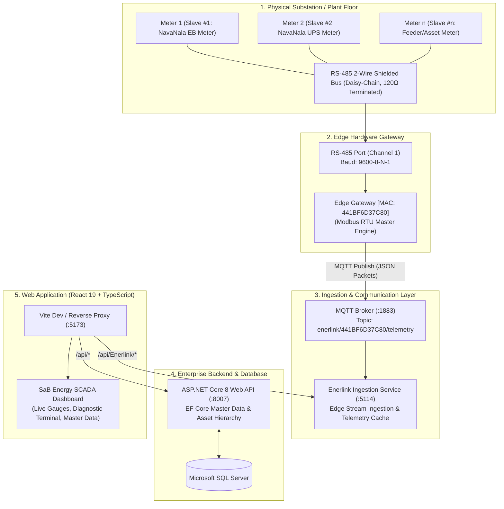
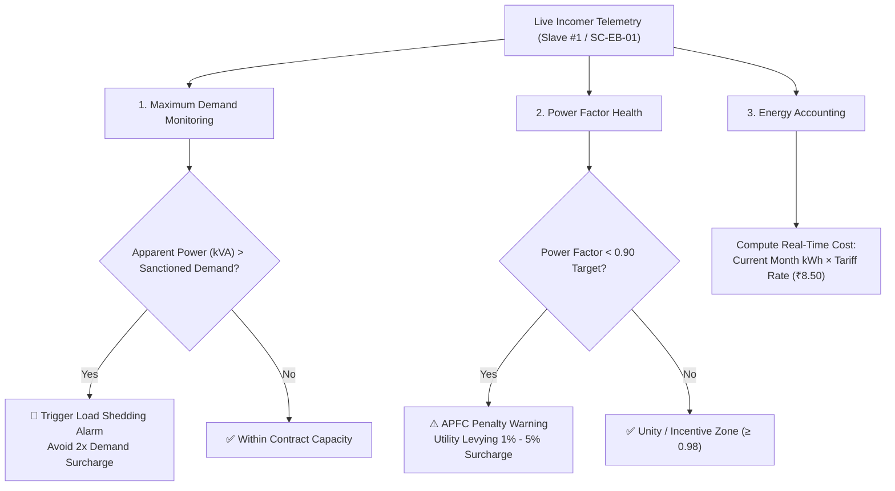

# SaB Energy — Industrial IoT & SCADA Energy Management System (EMS)

[](https://www.typescriptlang.org/)
[](https://react.dev/)
[](https://vitejs.dev/)
[](https://tailwindcss.com/)
[](https://dotnet.microsoft.com/)
[](https://mqtt.org/)

An enterprise-grade, full-stack **Industrial IoT (IIoT) & SCADA Energy Management System (EMS)** designed for real-time factory power monitoring, multi-drop Modbus meter polling, edge gateway management, CT/PT asset mapping, tariff accounting, and hardware diagnostic testing.

---

## 📑 Table of Contents

1. [Executive Summary](#-executive-summary)
2. [End-to-End System Architecture](#-end-to-end-system-architecture)
3. [Deep-Dive Business Logic & Engineering Rules](#-deep-dive-business-logic--engineering-rules)
   - [3.1 Enterprise Hierarchy (Concern → Location → Service Connection)](#31-enterprise-hierarchy)
   - [3.2 Hardware Topology (Gateway → RS-485 Channel → Multi-Drop Slave IDs)](#32-hardware-topology)
   - [3.3 Modbus Register Decoding & Byte Endianness](#33-modbus-register-decoding--byte-endianness)
   - [3.4 CT / PT Multiplication Factor (MF) Formula](#34-ct--pt-multiplication-factor-mf-formula)
   - [3.5 Commercial Utility Tariffs, Maximum Demand (MD) & Power Factor (PF) Penalties](#35-commercial-utility-tariffs-maximum-demand-md--power-factor-pf-penalties)
   - [3.6 Communication Timing Rules (Polling vs. Publish)](#36-communication-timing-rules)
4. [Technology Stack](#-technology-stack)
5. [Repository Structure](#-repository-structure)
6. [API Specifications & Service Contracts](#-api-specifications--service-contracts)
   - [6.1 Relational Master Data API (ASP.NET Core / SQL Server)](#61-relational-master-data-api)
   - [6.2 Enerlink Edge Telemetry API (MQTT / localhost:5114)](#62-enerlink-edge-telemetry-api)
7. [Environment Configuration](#-environment-configuration)
8. [Developer Setup & Deployment Guide](#-developer-setup--deployment-guide)
9. [Hardware Telemetry Diagnostic Terminal](#-hardware-telemetry-diagnostic-terminal)
10. [Frontend Development Invariants](#-frontend-development-invariants)

---

## 📌 Executive Summary

**SaB Energy** bridges industrial electrical infrastructure with modern web engineering. In high-power industrial facilities, electricity bills often reach millions of rupees per month. Facilities face severe financial penalties if their **Maximum Demand (kVA)** exceeds contract limits or if their **Power Factor (PF)** drops below utility thresholds.

This platform provides:
- **Sub-second edge telemetry ingestion** from multi-vendor digital energy meters (Elmeasure, Schneider, Selec, Socomec).
- **Proactive utility penalty avoidance** (Maximum Demand shaving and APFC capacitor bank health monitoring).
- **Comprehensive Master Data Management (MDM)** for enterprise hierarchies, edge hardware, Modbus profiles, and single-line feeder circuits.
- **Hardware-in-the-loop diagnostics** allowing field engineers to test RS-485 frames and verify physical wiring before commissioning.

---

## 🏗️ End-to-End System Architecture



---

## 🧠 Deep-Dive Business Logic & Engineering Rules

### 3.1 Enterprise Hierarchy
The platform organizes enterprise power metering using a strict 3-tier hierarchy:
```
Concern (e.g., NavaNala CON-67)
└── Location (e.g., Main Substation / LT Panel Room)
    └── Service Connection (e.g., SC-EB-01 - NavaNala EB Incomer)
        └── Physical Meter Mapping (e.g., NavaNala_EB_Meter, Slave ID #1)
```

1. **Concern**: The top-level corporate entity, manufacturing plant, or billing organization.
2. **Location**: The physical site, substation, transformer yard, or building floor.
3. **Service Connection (Service No)**: The official commercial Electricity Board (EB) utility consumer identifier. Contains contractual metadata:
   - **Sanctioned Demand ($kW / kVA$)**: Contracted capacity with the power utility.
   - **Tariff Category**: HT-1A Industrial, Commercial, or Time-of-Day (ToD).
   - **Target Power Factor**: Billing baseline (typically `0.98` or `0.95`).

---

### 3.2 Hardware Topology

```
Gateway [441BF6D37C80]
├── Channel 1 (RS-485 Port 1) ─── Max 32 Multi-Drop Nodes
│   ├── Slave #1 (NavaNala EB Incomer Meter - LG+5310)
│   ├── Slave #2 (NavaNala UPS Backup Meter - LG+5310)
│   └── Slave #3 (Compressor Panel Meter)
└── Channel 2 (RS-485 Port 2)
    └── Slave #1 (Solar Farm Generation Inverter)
```

- **Physical Bus Rules**: Meters are daisy-chained in a linear bus using shielded twisted-pair cabling (A/+, B/-, Shield grounded at Gateway only). Star topologies are prohibited to prevent waveform distortion.
- **Node Address (Slave ID)**: Every meter on the **same physical channel must have a unique Modbus Slave ID (1–247)**.
- **Port Matching**: All meters sharing a channel must operate on identical baud rates (e.g., `9600`), data bits (`8`), parity (`None`), and stop bits (`1`).

---

### 3.3 Modbus Register Decoding & Byte Endianness

Industrial meters store electrical parameters in 16-bit registers (Function Code `03` Holding Registers or `04` Input Registers).

| Parameter | Standard Register | Data Type | Byte Order | Scaling / Unit |
| :--- | :--- | :--- | :--- | :--- |
| **Voltage L-N (R, Y, B)** | 30001, 30003, 30005 | `Float32` (2 registers) | `CDAB` (Word Swapped) | `Volts (V)` |
| **Voltage L-L (RY, YB, BR)** | 30007, 30009, 30011 | `Float32` | `CDAB` | `Volts (V)` |
| **Current (R, Y, B, Avg)** | 30013, 30015, 30017, 30019 | `Float32` | `CDAB` | `Amperes (A)` |
| **Total Active Power ($P$)** | 30021 | `Float32` | `CDAB` | `Kilowatts (kW)` |
| **Total Reactive Power ($Q$)** | 30023 | `Float32` | `CDAB` | `kVAR` |
| **Total Apparent Power ($S$)** | 30025 | `Float32` | `CDAB` | `kVA` |
| **Power Factor ($PF$)** | 30027 | `Float32` | `CDAB` | Dimensionless (0.00 – 1.00) |
| **Frequency ($f$)** | 30029 | `Float32` | `CDAB` | `Hertz (Hz)` |
| **Active Energy Import** | 30031 | `Int32` / `Float32` | `CDAB` | `kWh` |

> [!NOTE]
> Different manufacturers use different endianness. Elmeasure meters typically format 32-bit floats as `CDAB` (Little-Endian Word Swap), whereas Schneider meters default to `ABCD` (Big-Endian). The **Meter Profile Master** allows per-model register byte swap configuration.

---

### 3.4 CT / PT Multiplication Factor (MF) Formula

Because meters cannot tolerate high plant currents (e.g., 400A or 800A), external **Current Transformers (CTs)** and **Potential Transformers (PTs)** step down raw electrical signals.

$$\text{Overall Multiplying Factor (MF)} = \left(\frac{\text{CT Primary}}{\text{CT Secondary}}\right) \times \left(\frac{\text{PT Primary}}{\text{PT Secondary}}\right) \times \text{Meter Scale Factor}$$

#### Example:
- **CT Specification**: `400 / 5 A` $\rightarrow \frac{400}{5} = 80$
- **PT Specification**: Direct Low Tension ($415V$) $\rightarrow \frac{1}{1} = 1$
- **Meter Register Value**: `2.95 kW`
$$\text{True Feeder Power} = 2.95 \times 80 = \mathbf{236.0\text{ kW}}$$

The **Asset Mapping Engine** automatically applies this multiplier to all raw readings before rendering graphs and calculating consumption metrics.

---

### 3.5 Commercial Utility Tariffs, Maximum Demand (MD) & Power Factor (PF) Penalties

The platform exists to protect industrial facilities from three critical commercial utility charges:



---

### 3.6 Communication Timing Rules

The system enforces strict operational constraints between the Edge Hardware and Cloud/Local Server:

1. **Device Polling Interval**:
   - Minimum: **30 seconds** (configured on the edge gateway).
   - The Gateway executes round-robin polling over the RS-485 bus:
     $$\text{Poll Slave \#1} \longrightarrow \text{Wait 150ms} \longrightarrow \text{Poll Slave \#2} \longrightarrow \text{Wait 150ms} \longrightarrow \text{Poll Slave \#3}$$
2. **MQTT Publish Interval**:
   - **Constraint**: $\text{MQTT Publish Interval} \ge \text{Device Polling Interval}$.
   - The Gateway bundles all collected meter readings into a unified JSON frame and transmits it over MQTT.
   - Setting a publish interval lower than the polling interval is blocked by validation logic.

---

## 🛠️ Technology Stack

### Frontend Application
- **Runtime & UI**: React 19.3.1, TypeScript 5.9.3, Vite 8.3.4
- **CSS Architecture**: Custom Tokenized CSS Design System + Tailwind CSS v4.0
- **Visualizations**: Custom SVG Radial Concentric Progress Gauges, Capsule Donut Charts, Recharts line & bar series
- **Icons**: Lucide React
- **HTTP Client**: Native Fetch API client with automatic token attachment, unified error parsing, and multi-endpoint fallback

### Backend & Edge Ingestion
- **Relational Enterprise API**: ASP.NET Core 8 Web API, Entity Framework Core, Microsoft SQL Server
- **Edge Telemetry Service**: Enerlink Ingestion Bridge (Port `5114`), MQTT Protocol (Broker port `1883`)

---

## 📂 Repository Structure

```
vishalini-SaB Energy/
├── public/                          # Static assets and icons
├── src/
│   ├── components/                  # Global shared UI components
│   │   ├── common/                  # Modals, Select2, PageHeader, LoadingScreen, Combobox
│   │   └── layout/                  # Navigation Header, Breadcrumbs, Theme Switcher
│   ├── context/
│   │   └── EnergyDataContext.tsx    # Central state provider, fleet cache, master data synchronization
│   ├── modules/                     # Modular domain-driven architecture
│   │   ├── asset-mapping/           # CT/PT calculation formulas, equipment allocation
│   │   ├── comm-configuration/      # Device ID, Polling & MQTT interval push (/api/Enerlink/configuration)
│   │   ├── energy-dashboard/        # Real-time dashboard, multi-ring voltage gauge, capsule donut charts
│   │   │   ├── components/          # MeterTelemetryCard, EnergyDistributionPieChart, FilterToolbar
│   │   │   └── pages/               # EnergyDashboardPage.tsx
│   │   ├── gateways-devices/        # Gateway inventory, RS-485 channels, meters, diagnostic terminal
│   │   │   ├── api/                 # gatewayApi.ts, channelApi.ts, meterApi.ts
│   │   │   └── pages/               # GatewaysDevicesPage.tsx
│   │   └── masters/                 # Enterprise master data tables
│   │       ├── gateway-master/      # Gateway Make & Model Masters
│   │       ├── meter-master/        # Meter Make & Model, Parameter Dictionary, Meter Profiles
│   │       └── service-master/      # Concerns, Locations, EB Service Connections (Service Master)
│   ├── services/
│   │   ├── client.ts                # Resilient HTTP request client with fallback candidates
│   │   ├── enerlinkApi.ts           # Interface to localhost:5114 (telemetry, test-connection, configuration)
│   │   └── idHelper.ts              # Integer ID normalization for ASP.NET / EF Core compliance
│   ├── styles/                      # Global theme variables (Light/Dark mode)
│   ├── App.tsx                      # Root component & module view switcher
│   ├── main.tsx                     # React root DOM mounting
│   └── vite.config.ts               # Vite proxy configuration (/api & /api/Enerlink)
├── .env.development                 # Development environment endpoint variables
├── package.json                     # Node.js dependencies and run scripts
└── tsconfig.json                    # Strict TypeScript compilation rules
```

---

## 🔌 API Specifications & Service Contracts

### 6.1 Relational Master Data API
Interfaced at `http://192.23.1.7:8007/api/*` (Proxied via Vite to `/api/*`):

#### 1. Gateways (`/api/Gateway/gateways`)
- `GET /GetAll`: Retrieves all registered hardware gateways.
- `POST /Create`: Provision new edge gateway (`deviceName`, `serialNo`, `macAddress`, `ipAddress`, `keepaliveTime`).
- `PUT /Update?id={id}`: Update gateway configuration.
- `DELETE /Delete?id={id}`: Remove gateway.

#### 2. Channels (`/api/Channel/channels`)
- `GET /GetAll`: Retrieves RS-485 and TCP communication channels.
- `POST /Create`: Bind port to gateway (`channelNo`, `baudRate`, `parity`, `gatewayId`).

#### 3. Meters (`/api/Meter/meters`)
- `GET /GetAll`: Returns all configured multi-drop meters.
- `POST /Create`: Create meter under channel:
  ```json
  {
    "serialNo": "ELM-EB-001",
    "customName": "NavaNala EB Meter",
    "channelId": 1,
    "slaveId": 1,
    "deviceProfileId": 1,
    "meterMakeId": 1,
    "meterModelId": 1,
    "status": "Active",
    "baudRate": 3,
    "parityBit": "None",
    "stopBit": 1,
    "dataBit": 8,
    "isActive": true
  }
  ```

---

### 6.2 Enerlink Edge Telemetry API
Interfaced at `http://localhost:5114/api/Enerlink/*` (Proxied via Vite to `/api/Enerlink/*`):

#### 1. Hardware Connection Test
- **Endpoint**: `POST /api/Enerlink/test-connection`
- **Payload**: `{ "cmd": "test", "device_id": "441BF6D37C80" }`
- **Response**: `{ "isSuccess": true, "connected": "YES", "deviceId": "441BF6D37C80" }`

#### 2. Fetch Latest Telemetry
- **Endpoint**: `GET /api/Enerlink/devices/{deviceId}/telemetry/latest?slaveId={slaveId}`
- **Response**:
  ```json
  {
    "device_id": "441BF6D37C80",
    "channel": 1,
    "slave_id": 1,
    "meter_name": "NavaNala EB Meter",
    "timestamp_ms": 1731817252000,
    "values": [
      {
        "total_active_power": 2950.0,
        "line_to_line_voltage": 396.1,
        "line_to_neutral_voltage": 229.9,
        "average_current": 4.50,
        "frequency": 50.09,
        "power_factor": 0.98,
        "active_energy": 4445200.0
      }
    ]
  }
  ```

#### 3. Communication Configuration
- **Endpoint**: `GET /api/Enerlink/configuration?deviceId={deviceId}`
- **Endpoint**: `POST /api/Enerlink/configuration`
- **Payload**:
  ```json
  {
    "device_id": "441BF6D37C80",
    "deviceId": "441BF6D37C80",
    "cmd": "set_comm_config",
    "polling_time": 30,
    "MQTT_publish": 300
  }
  ```

---

## ⚙️ Environment Configuration

Configuration variables are managed in `.env.development`:

```ini
# Local Vite Development Host
VITE_UI_HOST=http://localhost:5173

# ASP.NET Core Master Data API Backend
VITE_BACKEND_URL=http://192.23.1.7:8007

# Enerlink Real-Time Edge Telemetry & MQTT Service
VITE_ENERLINK_URL=http://localhost:5114
```

Vite proxies incoming frontend requests:
- `/api/Enerlink` $\longrightarrow$ `http://localhost:5114`
- `/api` $\longrightarrow$ `http://192.23.1.7:8007`

---

## 🚀 Developer Setup & Deployment Guide

### Prerequisites
- **Node.js**: `v20.0.0` or higher
- **npm**: `v10.0.0` or higher
- **Edge Ingestion Service**: Enerlink service running on `http://localhost:5114`
- **Database Server**: Access to ASP.NET Core backend at `http://192.23.1.7:8007`

### 1. Installation
```bash
# Clone the repository
git clone <repository-url>
cd vishalini-SaB-Energy

# Install all npm dependencies
npm install
```

### 2. Run Development Server
```bash
npm run dev
```
The application will launch with Hot Module Replacement (HMR) at:
👉 `http://localhost:5173`

### 3. Production Compilation & Verification
```bash
# Typecheck and compile production bundle
npm run build
```
Build output compiles into `dist/` in under 3 seconds.

---

## 🔬 Hardware Telemetry Diagnostic Terminal

The application includes an integrated **Hardware Diagnostic Console** under `Gateways & Devices` &rarr; `Channel 1` &rarr; `Test`:

1. **Handshake Verification**: Sends a probe command to the gateway over network/MQTT to measure round-trip ping latency.
2. **RX Hardware Frame Verification**: Queries the meter on the RS-485 bus via Modbus RTU using its specific Slave ID (`#1`, `#2`).
3. **Automated Status Promotion**:
   - **On Success**: Automatically updates meter status to **`● Active`** in the local database and dashboard.
   - **On Timeout**: Flags an RX timeout error, alerts that the physical line or meter is unacknowledged, and marks status as **`● Offline`**.

---

## 🛡️ Frontend Development Invariants

When contributing to this codebase, the following invariants must be strictly preserved:

1. **`dist/web.config` Invariant**:
   - `dist/web.config` must **NEVER** exist in the repository or build output. IIS web configs outside designated production packages cause deployment collision errors.
2. **Clean Typing & Foreign Keys**:
   - Primary and foreign keys communicated to the ASP.NET Core backend must be normalized to 32-bit positive integers using `resolveIntegerId` in `src/services/idHelper.ts`.
3. **Reactive Polling Without Loops**:
   - Real-time components use interval-driven lifecycle updates or event streams. Infinite re-render cascades are guarded using `useRef` snapshots.
4. **Resilient Local Fallback**:
   - If the remote backend is temporarily unreachable during plant maintenance, master data operates smoothly via `EnergyDataContext` local storage persistence.

---

*Authored by the SaB Energy Full-Stack Engineering Team.*
